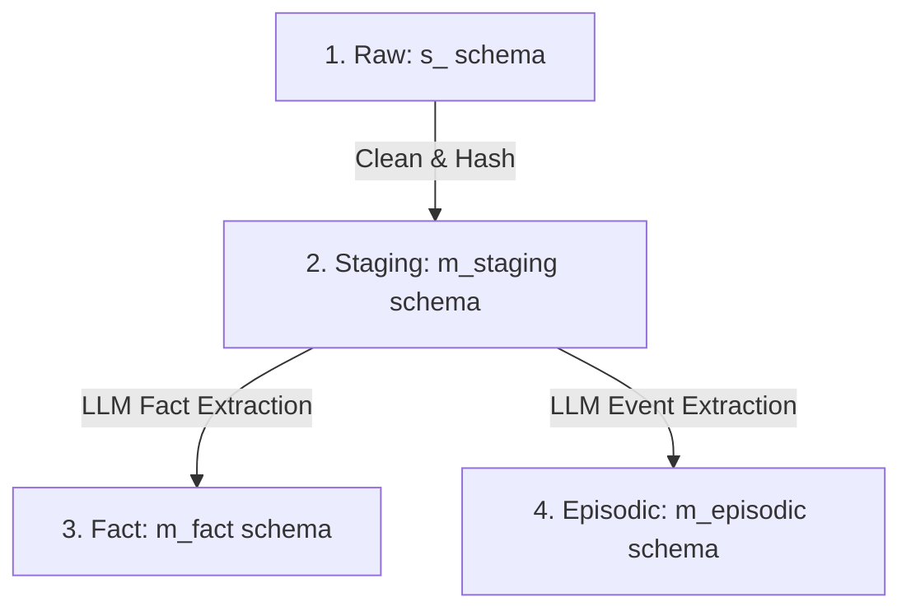

# AI Memory & Entity-Centric Learning (ECL)

This directory contains workflows driving Jager's AI memory capabilities using the **Distillion Pattern**, plus thin DAPP VectorDB connector schedules.

---

## Four-Layer Memory Architecture

1. **Raw Layer (`s_*`)**: Stores unmodified records from external APIs with `processed = 0`.
2. **Staging Layer (`m_staging`)**: Normalised and deduplicated using SHA-256 `content_hash` primary keys.
3. **Fact Layer (`m_fact`)**: Static profile facts and entity knowledge extracted by LLMs (`m_fact.memory_facts`).
4. **Episodic Layer (`m_episodic`)**: Context-aware events, touchpoints, and timeline decisions (`m_episodic.memory_events`).

---

## Memory workflows

- [`ai_memory_distillion_staging.json`](ai_memory_distillion_staging.json)
- [`ai_memory_distillion_facts_episodic.json`](ai_memory_distillion_facts_episodic.json)
- [`ai_memory_embeddings.json`](ai_memory_embeddings.json)

---

## DAPP VectorDB connectors

[`dapp_connectors_notion_substack.json`](dapp_connectors_notion_substack.json) — daily schedule that POSTs to DAPP with `X-API-Key`:

* `POST /run/connectors/notion?mode=vectordb`
* `POST /run/connectors/substack`

Base URL: `{{ $env.DATA_PIPELINE_URL || 'http://dapp-api:8000' }}`. These are **not** MotherDuck ingest paths.
